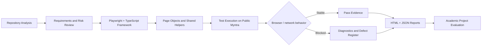

# Myntra E-Commerce Website Test Automation Using Playwright and TypeScript

## Cover Page

Student / Project Author: Aryan Sahu  
Project Title: Myntra E-Commerce Website Test Automation Using Playwright and TypeScript  
Discipline: Computer Science / Information Technology / Software Engineering  
Institution: [To be filled by the university]  
Academic Year: 2026-2027  
Project Type: Academic Mini / Major Project Report  

---

## Title Page

Myntra E-Commerce Website Test Automation Using Playwright and TypeScript

Submitted in partial fulfilment of the requirements for the degree of [B.Tech / B.E. / M.Tech / Diploma] in [Department / Specialization]

Submitted by:  
Aryan Sahu

Guided by:  
[Project Guide Name]  
[Designation / Department]

Department of [Department Name]  
[College / University Name]  
[City, State]

---

## Bonafide Certificate

This is to certify that the project work entitled

Myntra E-Commerce Website Test Automation Using Playwright and TypeScript

has been carried out by Aryan Sahu in partial fulfilment of the requirements for the award of the degree of [Degree Name] in [Department Name] during the academic year [Year].

This work has been reviewed and is approved for submission.

Signature of HOD: ______________________  
Name: ________________________________  
Date: ________________________________

Signature of Guide: ____________________  
Name: ________________________________  
Date: ________________________________

---

## Acknowledgement

I would like to express my sincere gratitude to [Guide Name], [Department], for guidance, suggestions, and steady support during this project. I also thank the faculty and staff of [Institution] for providing the environment to learn and execute practical software testing work.

This project is a real-world quality assurance exercise on the public Myntra storefront. It helped me understand live-browser automation, third-party site constraints, safe testing ethics, and evidence-based testing. I am grateful for the opportunity to learn how automated checks behave under real network and UI conditions, especially when the product under test is not under our direct source control.

I also acknowledge the importance of preserving evidence, documenting failed runs honestly, and treating live-site blockers as engineering facts instead of defects. This discipline is a key learning outcome of this project.

---

## Table of Contents

1. Introduction  
2. Literature Survey  
3. Design Flow / Process  
4. Results Analysis and Validation  
5. Conclusion and Future Work  
6. References  
7. Appendices  
8. User Manual  
9. Achievements

---

## List of Figures

1. Figure 1: Graphical abstract of the Playwright test automation workflow  
2. Figure 2: High-level system architecture  
3. Figure 3: Page-object and test-suite interaction model  
4. Figure 4: Browser project execution model  
5. Figure 5: Test-result evidence flow from Playwright to HTML/JSON reports  
6. Figure 6: Example of live-site failure classification (HTTP/2 and locator issues)

---

## List of Tables

1. Table 1: Technology stack and selection rationale  
2. Table 2: Test suite inventory and coverage  
3. Table 3: Browser/project execution model  
4. Table 4: Failure analysis and evidence summary  
5. Table 5: Requirements traceability mapping  
6. Table 6: Execution evidence summary from actual project runs  
7. Table 7: Limitations and future work

---

## Abstract

This project presents a black-box test automation implementation for the live public Myntra storefront using Playwright and TypeScript. The repository under study is an actual automation project, not a cloned Myntra application, and the objective is to validate selected user journeys in an ethically safe, low-volume, and evidence-driven manner. The work includes homepage validation, search behavior checks, category browsing, product detail verification, empty-bag checks, responsive checks, and limited accessibility verification. The project also records browser-specific blockers and live-site instability rather than hiding them.

The critical learning outcome is the design of automation that operates on a third-party website whose UI and network behaviour are not completely under the tester’s control. The repository uses Playwright Test with four configured browser profiles: Chromium desktop, Firefox desktop, WebKit desktop, and Chromium mobile emulation. It employs TypeScript and page-object abstraction to structure test logic, and it produces HTML and JSON reports plus screenshot, video, and trace artifacts for failure evidence.

The implemented repository contains 27 unique discovered test definitions in 12 spec files. Actual evidence from the project shows that the latest full Firefox run produced 20 passed, 6 failed, and 1 skipped case, while a separate multi-project smoke run produced 5 passed and 3 failed executions. These results are not presented as a generic “project success”; rather, the project documents failures such as the Chromium HTTP/2 transport error, the mobile search locator mismatch, and responsive assertions that depend on a live site. This honest evidence-based approach is consistent with professional software quality engineering and academic integrity.

The report further evaluates the project using the actual repository evidence, including the configuration files, page object classes, execution scripts, failure artifacts, and the repository’s audit and coverage documentation. The final conclusion recognises both the project’s automation maturity and the current live-site limitations, while identifying directions for future improvement such as mobile search hardening, more stable browser coverage, and expanded product-journey validation.

---

## Graphical Abstract



Figure 1: Graphical abstract of the Playwright-based live-site QA workflow.

---

## Abbreviations, Symbols and Nomenclature

- API: Application Programming Interface  
- CI: Continuous Integration  
- DOM: Document Object Model  
- E2E: End-to-End  
- HTML: HyperText Markup Language  
- HTTP: HyperText Transfer Protocol  
- JSON: JavaScript Object Notation  
- NFR: Non-Functional Requirement  
- POM: Page Object Model  
- QA: Quality Assurance  
- SUT: System Under Test  
- UI: User Interface  
- URL: Uniform Resource Locator  
- WCAG: Web Content Accessibility Guidelines  
- XPath: XML Path Language  
- TypeScript: Microsoft’s typed JavaScript superset  
- Playwright: Open-source browser automation framework

---

# Chapter 1 — Introduction

## 1.1 Introduction to software testing and e-commerce automation

Software testing is a critical activity in the software development lifecycle because it validates whether products satisfy business and user expectations. In modern web applications, testing is especially important due to changing user interfaces, asynchronous content, external services, real-time performance considerations, and evolving browsers. The weakest point in many product teams is not just coding, but converting product requirements into reliable test evidence that can survive changes in the application and user environment.

E-commerce websites such as Myntra are highly dynamic platforms with responsive layouts, large catalog data, user-generated product metadata, region-based content, and browser-dependent rendering. Testing such systems manually is expensive and error-prone; automated browser tests provide better repeatability, faster feedback, and systematic regression coverage. However, live storefronts also introduce a distinct challenge: the application is public, third-party, and subject to network volatility. Therefore, automation must be designed with guardrails that prevent destructive behavior while gathering reliable evidence.

This project addresses that challenge by implementing Playwright and TypeScript-based automation against the public Myntra website. The testing is intentionally safe: no checkout, payment, or private-account activity is executed. The automation focuses on public browsing, search, page identity, category browsing, add-to-bag preconditions, and repair/cleanup flows, while also documenting environmental blockers honestly.

## 1.2 Project background

The underlying project repository, `fashion-ecommerce-test-automation`, provides a live-site automation suite for the public Myntra storefront. The project is not a full clone of Myntra’s e-commerce platform; instead, it automates selected public storefront interactions in a black-box fashion. This makes the project a realistic testing exercise because it tests the real website as a user would see it, rather than a local mock or static demo.

The repository contains Playwright configuration for Chromium desktop, Firefox desktop, WebKit desktop, and a mobile Chromium project. It includes test scripts, page object classes, a demo runner, and evidence generation scripts. The implementation used a structured approach to test planning, test execution, and reporting across both live and browser-variant conditions.

## 1.3 Identification of the client/system under test

The system under test is the public Myntra e-commerce website located at `https://www.myntra.com/`. The test automation is designed to interact with the public storefront and verify safe, visible user journeys without modifying private account data or processing payment.

The project therefore belongs to the domain of black-box web automation for a live retail website. The test suite is intended to validate the public interface with respect to navigation, search, product listing, product details, bag precondition checks, and limited accessibility/responsive behaviour.

## 1.4 Need for the project

E-commerce platforms need continuous quality assurance because their content, page structure, and navigation logic change frequently. A few examples of common quality risks include broken search flows, mobile layout regressions, inaccessible forms, cart logic errors, and performance problems caused by live content or ad renders.

Testing a real e-commerce site requires a disciplined strategy because there is no guaranteed guarantee that every browser, device, and network condition behaves the same way. This project addresses the need for:

- Safe browser automation against public commerce UI
- Regression checks for core browsing flows
- Evidence-based reporting rather than assumed success
- Detection and documentation of live-site blockers
- A practical academic demonstration of modern automation tooling

## 1.5 Contemporary issues in e-commerce testing

Modern e-commerce sites are challenging to test due to complex front-end frameworks, browser rendering differences, third-party scripts, personalized content, dynamic product catalog data, and security-related UI controls such as CAPTCHA or account gating. These conditions create a mismatch between laboratory assumptions and production reality.

The project specifically encountered and documented several modern testing challenges:

- Browser-level transport errors in desktop Chromium
- Mobile UI differences for search affordances
- Visual overflow and responsive layout issues at smaller widths
- Site-specific dynamic behavior and live network conditions
- Limited or blocked access to authenticated purchase workflows

These issues are not isolated defects in the automation code alone; they reflect the complexity of testing live e-commerce systems in real environments.

## 1.6 Problem identification

The core problem addressed by this project is the lack of a reliable, safe, evidence-based automated QA workflow for a public e-commerce website that is under active change. Manual testing alone is not scalable, while unstructured automation often produces brittle scripts and false confidence.

The repository was designed to implement a balanced solution: it automatically validates a limited but useful set of public user journeys, captures evidence, and records blockers rather than hiding them. This is particularly important when the system is live and not under local development control.

## 1.7 Task identification

The specific project tasks are:

1. Configure a Playwright + TypeScript test environment
2. Validate homepage availability and basic storefront identity
3. Test search controls and query boundary conditions
4. Implement category and product browsing journeys
5. Verify safe empty-bag and add-to-bag guard behaviour
6. Capture browser-specific failures and report them objectively
7. Produce HTML/JSON reports and trace evidence
8. Create a project-level documentation set for academic review

## 1.8 Project objectives

The principal objectives of this project are to:

- Build a browser automation framework for a live e-commerce site
- Create safe, non-destructive test cases for public user journeys
- Validate critical browsing features across browsers
- Provide evidence of pass/fail outcomes using real execution records
- Explain blockers and limitations in a professional manner
- Develop a project report that demonstrates learning and engineering discipline

## 1.9 Scope

The actual scope of the implemented project is focused and practical. The repository supports the following major areas:

- Homepage testing
- Search input and search query validation
- Empty-bag logic verification
- Product listing and category browsing
- Product detail and add-to-bag validation
- Responsive checks at selected viewport widths
- Accessibility-oriented search control checks
- Reporting and demo evidence capture

The project does not claim full end-to-end payment testing, complete WCAG certification, or authenticated purchase flow validation because those features require controlled accounts, secure handling, and valid business operations that are outside the safe testing scope.

## 1.10 Project constraints

The implementation operates under several constraints:

- The target application is a live third-party website and is subject to real-time changes.
- The automation must remain safe and low-volume.
- Automated checkout or payment is explicitly avoided.
- No production user credentials or personal data are used.
- Browser and network behaviour may differ across environments.
- Some product pages and UI components are not stable enough to support fully reliable automation without adaptation.

## 1.11 Project timeline

The project progressed through several phases, including: project setup, Playwright configuration, search path validation, bag-flow implementation, responsive and accessibility checks, documentation, and audit. The repository’s project state notes and reports reflect continuous revision and hardening. The most recent audit date represented in the project records is 2026-11-01.

## 1.12 Organisation of the report

This report is organized in the conventional university format. Chapter 2 surveys relevant literature and the evolution of software testing automation. Chapter 3 presents the design flow and architecture of the project. Chapter 4 analyses the results and validation evidence using actual run outputs and repository artifacts. Chapter 5 summarises the project outcomes, limitations, and future work. The later sections include references, appendices, a user manual, and an achievements summary.

---

# Chapter 2 — Literature Survey

## 2.1 Evolution of software testing automation

Software testing has evolved from manual checklists and script-based procedures to automated, scriptable validation systems that can execute in browsers, CI pipelines, and cloud environments. The increasing scale and complexity of applications, especially in web and e-commerce domains, necessitate automation because manual validation lacks repeatability, speed, and consistency.

The main drivers behind automation include repetitive regression checks, faster feature delivery, continuous integration, and better evidence generation. In the context of web commerce, browser automation is important because destinations such as search results, filters, product pages, and carts behave differently under varied browser engines and viewport sizes.

## 2.2 History and development of web automation

Early web automation relied on browser scripting and lower-level DOM manipulation tools. With the popularity of dynamic web applications, frameworks evolved to support more realistic interaction with real browser events. Tools such as Selenium introduced browser automation across multiple platforms, but tests often required careful synchronization and sometimes struggled with reliability on complex single-page interfaces.

Later frameworks introduced stronger browser-automation abstractions, better waiting strategies, and tighter support for dynamic user interactions. Playwright represents a significant step forward because it handles browser context management, network interception, selectors, animations, and observability features in a more integrated way. This makes it particularly suitable for testing modern e-commerce UIs, where page rendering and script timing vary widely.

## 2.3 Selenium and browser automation background

Selenium became a foundational technology for automated browser testing. It introduced the concept of programmatically controlling a browser, simulating user actions, and validating expected UI state. It remains widely used in industrial testing and in educational contexts because it supports multiple programming languages and browsers.

However, Selenium-based automation frequently demands additional configuration for waiting, browser startup, driver compatibility, and handling dynamic content. E-commerce sites often render product cards, promotional content, and navigation controls asynchronously, which increases fragility if tests are not designed with robust waits and explicit assertions. The project’s use of Playwright addresses this with built-in auto-waiting, browser context isolation, and modern testing ergonomics.

## 2.4 Playwright and modern browser automation

Playwright is now one of the leading browser automation frameworks for end-to-end testing. It supports Chromium, Firefox, and WebKit, offers emulated mobile context testing, and produces screenshots, trace files, videos, and HTML reports. It also supports tag-based test grouping, CI integration, and stable browser automation without requiring a separate driver layer.

In the present project, Playwright is used to automate the live Myntra website across multiple browser profiles. The repository uses `@playwright/test` in TypeScript, configures browser device emulation, and records failure artifacts. This is aligned with modern web testing best practices because it allows the test suite to remain close to real user events while collecting actionable evidence.

## 2.5 TypeScript in test automation

TypeScript is a strong fit for automation projects because it adds type safety, code readability, and maintainability to test scripts. In a large test suite, this helps reduce runtime errors caused by incorrect selectors, malformed objects, or mismatched assumptions. TypeScript also improves traceability and project structure when combined with page objects and utility modules.

In this repository, TypeScript is used with Playwright to normalize a maintainable codebase for page abstractions such as `HomePage`, `SearchPage`, `CategoryPage`, and `ShoppingBagPage`. This structure reduces duplication, makes test code easier to read, and supports scaling the framework when more scenarios are added.

## 2.6 Existing research on automated web testing

Research in software testing highlights the importance of combining test planning, domain analysis, and automation framework design. Studies in web application testing emphasise that the highest-value tests are those that target critical user journeys, validate fixed business rules, and remain resilient under live UI changes. At the same time, research warns against generating shallow tests that pass for the wrong reasons or rely on assumptions that are never validated against real browser behaviour.

For retail and e-commerce sites, the greatest operational risk is often in user flows that depend on catalog data, hidden metadata, filters, cart state, and dynamic page rendering. A good automation system must therefore balance breadth, stability, and realism. This project adopts that principle by focusing on the public storefront rather than internal admin features or payment flows.

## 2.7 Cross-browser testing

Cross-browser testing is essential because layout, parsing, accessibility, and script execution can vary across browsers. The project explicitly configures browser projects for Chromium desktop, Firefox desktop, WebKit desktop, and mobile Chromium. This helps detect issues caused by vendor-specific rendering or protocol differences.

The actual project evidence indicates that browser behaviour differs significantly in real-world live conditions. The latest runs show that Firefox and WebKit passed most desktop cases, while Chromium desktop encountered `ERR_HTTP2_PROTOCOL_ERROR` at navigation. This is a concrete example of why cross-browser validation matters and why test evidence must not be aggregated without acknowledging browser differences.

## 2.8 Regression testing

Regression testing is necessary for e-commerce platforms because repeated changes to product cards, filters, and layout can silently break user journeys. In this repository, tests are organized using tags such as `@smoke`, `@search`, `@bag`, `@accessibility`, and `@regression`. The project uses filtered runs for targeted validation and supports a fuller regression pass when the environment and site are stable.

This is a useful and realistic QA design because it allows rapid identification of newly broken flows while preserving a stable subset of checks for smoke and targeted validation. The project also records that its latest full regression run in Firefox produced a mixture of pass and fail results, highlighting the need for an ongoing hardening process instead of a single static assertion set.

## 2.9 Test design techniques

The implemented test suite reflects multiple test design techniques already identified in the repository documentation:

- Equivalence partitioning: valid query vs. empty query, product available vs. unavailable size
- Boundary value analysis: empty, whitespace, Unicode, punctuation, and 80-character queries
- Decision tables: whether a size is selected before add-to-bag action
- State transitions: empty bag to item added and then removed
- Risk-based testing: verifying safe item cleanup and preventing accidental checkout
- Responsive testing: checking overflow at specific viewport widths

These techniques are also consistent with modern QA practice because they aim to cover important input classes and state changes without generating excessive redundant cases.

## 2.10 Test automation reliability and honesty

A reliable automation project does not only report passing checks; it also records failures clearly and avoids overstating coverage. The repository documents that it uses real browsers and a live site, which means that some test outcomes are affected by network quality, browser stability, and site behavior. This is important because live-site automation should report blockers as blockers, not as pass results.

The project’s documentation demonstrates this principle. It identifies issues such as HTTP/2 navigation failures, search locator differences on mobile, and page setup timeouts for long queries. This disciplined view aligns with professional test engineering and is a better academic outcome than a generic “all tests passed” statement.

## 2.11 Comparison of modern approaches

| Approach | Strengths | Limitations | Suitability for live Myntra automation |
|---|---|---|---|
| Selenium-based automation | Mature ecosystem and broad language support | More driver and synchronization overhead | Good, but less ergonomic for dynamic retail pages |
| Playwright automation | Browser-native reliability, auto-waiting, traces, mobile emulation | Execution still depends on live-site stability | Highly suitable |
| Local mock app testing | Controlled deterministic behavior | Not representative of real storefront changes | Limited value for live-site QA |
| Manual testing only | Good for exploratory validation | Low repeatability and poor regression coverage | Useful only as complement |

This comparison demonstrates why Playwright was selected for the actual project.

## 2.12 Summary connecting literature to the project

The literature confirms that test automation must align with the real conditions of the software under test. In a live, dynamic e-commerce ecosystem, reliability depends not only on tool selection but also on disciplined execution, safe test design, and transparent evidence. The Myntra project demonstrates these principles through a Playwright-driven approach with honest reporting of pass/fail outcomes, browser differences, and external blockers.

---

# Chapter 3 — Design Flow / Process

## 3.1 Concept generation

The initial concept of the project was to automate business-relevant flows on a real e-commerce site without developing a cloned application. The project is deliberately black-box in nature: the application is treated as a customer-facing website to be exercised through browser automation. This is consistent with the broader goal of quality assurance by simulation of end-user behaviour.

The project uses a pragmatic, evidence-based design rather than a purely theoretical scope. It focuses on:

- homepage availability
- search performance and boundary validation
- category browsing
- product detail checks
- shopping-bag state handling
- selected mobile and accessibility checks

## 3.2 Requirement analysis

The project requirement analysis was based on the actual repository implementation and documented execution evidence. The following functional requirements were identified:

- The homepage must return the expected page identity and visible content
- Search controls must be available and interactable when they are exposed by the site
- Search queries must support normal, empty, whitespace, and Unicode/punctuation forms
- Product listing pages must load and expose products or result states
- Product detail pages must show expected metadata and size options
- Add-to-bag flows must verify correct item identity and size before the item is added
- Empty bag state must be handled safely and explicitly
- Reports must show pass/fail evidence and failure artifacts

The non-functional requirements include:

- Safe execution without payment or order placement
- Minimal and ethical network usage
- Maintainability of test logic using page objects
- Cross-browser support where practical
- Documentation of blockers and live-site failures

## 3.3 Functional and non-functional requirements

### Functional requirements

| ID | Requirement | Current status |
|---|---|---|
| FR-01 | Homepage loads and shows brand identity | Implemented and verified |
| FR-02 | Search entry field is visible when available | Partially verified |
| FR-03 | Empty search and valid search query cases work | Implemented and verified |
| FR-04 | Product listing pages are navigable | Implemented and verified in Firefox |
| FR-05 | Product detail page has relevant metadata | Implemented and verified |
| FR-06 | Bag preconditions are respected before item mutation | Implemented and verified |
| FR-07 | Test item is verified before removal | Implemented and verified |
| FR-08 | HTML/JSON results and trace artifacts are produced | Implemented and verified |
| FR-09 | Authenticated flow remains gated and optional | Implemented but not verified |

### Non-functional requirements

- Minimal interference with live public site
- Conformance with safe automation practices
- Code maintainability and reusability
- Browser coverage across multiple engines
- Evidence quality and documentation integrity

## 3.4 Design alternatives

### Alternative 1: Pure manual exploratory testing

This approach would require human testers to navigate the site repeatedly. It is flexible and useful for discovery, but it is slow, difficult to scale, and poorly suited to regression checking and repeatable evidence generation.

### Alternative 2: Static mock-based testing

This would use a local app or fixtures that mimic the storefront. It is deterministic and easier to control, but it fails to reflect live-site behavior, dynamic categories, and browser-rendering realities.

### Alternative 3: Live-site Playwright automation (selected approach)

This is the actual project approach. It interacts with the public storefront as a user would, records evidence, documents blockers and network variability, and remains safe because it avoids payments, private account access, and order placement.

## 3.5 Comparison of alternative approaches

| Design approach | Advantages | Disadvantages | Decision |
|---|---|---|---|
| Manual QA | Flexible and exploratory | Not scalable, inconsistent evidence | Not selected |
| Mock app testing | Fast and deterministic | Unrealistic for live retail behavior | Not selected |
| Live-site Playwright automation | Realistic, evidence-based, multi-browser support | Depends on live site and network behavior | Selected |

## 3.6 Evaluation and selection of final technology stack

The final technology stack was selected using the repository’s actual configuration and evidence. The selected stack is:

| Layer | Technology | Rationale |
|---|---|---|
| Runtime | Node.js | JavaScript runtime for test execution |
| Test framework | Playwright Test | Real browser automation with stable API and reporting |
| Language | TypeScript | Static typing and maintainability |
| Reporting | HTML/JSON reporters | Evidence generation |
| CI | GitHub Actions | Workflow automation and typechecking |
| Execution environments | Chromium, Firefox, WebKit, mobile emulation | Cross-browser validation |

This combination is highly suitable for browser automation of real public web applications because it provides browser-level realism and practical maintainability.

## 3.7 System architecture

The architecture of the project is structured in layers:

1. Browser automation layer
2. Page-object abstraction layer
3. Test specification layer
4. Reporting and metrics layer
5. Safety and evidence layer

Figure 2 below summarises the interaction model.

```text
Browser Environment
   │
   ▼
Playwright Test Runner
   │
   ├── HomePage / SearchPage / CategoryPage / ProductPage / ShoppingBagPage
   │
   ├── Shared support helpers (search field discovery, state checks, reporting scripts)
   │
   ├── Test specs (smoke, search, product, bag, accessibility, responsive)
   │
   └── HTML / JSON / screenshot / video / trace outputs
```

Figure 2: High-level system architecture of the Myntra automation project.

## 3.8 Test automation architecture

The repository organizes the automation according to a standard page object design. For example, the `pages` directory contains classes such as `BasePage`, `HomePage`, `CategoryPage`, `ProductPage`, `SearchPage`, and `ShoppingBagPage`. These classes abstract page logic, while individual `*.spec.ts` files define the actual test scenarios.

This approach improves maintainability because UI selectors and actions are separated from scenario logic. In live e-commerce environments, page structure can change; page object encapsulation makes it easier to update selectors or actions in one place.

## 3.9 Page Object Model, fixtures, and utilities

The repository demonstrates a page-object model in practice:

- `BasePage` defines shared helpers
- `HomePage` encapsulates homepage behaviour
- `SearchPage` abstracts search interactions
- `CategoryPage` handles product collection navigation
- `ProductPage` manages PDP checks
- `ShoppingBagPage` handles bag verification and cleanup

Support utilities include search discovery routines such as `findSearchField` and `requireSearchTextField`, which are designed to detect when the site exposes a standard textbox or search control. This is important because trial-and-error selectors on a public site can fail when the DOM is dynamic.

## 3.10 Test data management

The project uses a combination of:

- static dataset values such as search strings and product category names
- live-site selectors discovered at runtime
- no secret credentials or authentication state in source control
- optional local auth state for future scenarios only

This approach ensures that the automation remains ethically safe and does not hardcode private account data in the repository.

## 3.11 Video recording architecture

The Playwright configuration uses failure-only screenshot, video, and trace retention, as specified in `playwright.config.ts`. This design keeps the execution environment lean while ensuring that failures remain evidence-rich. The `demo-videos` folder also stores run recordings and execution summaries for demonstration use.

## 3.12 Reporting architecture

The project uses multiple report channels:

- `reports/html/index.html` for HTML result presentation
- `reports/results.json` for machine-readable execution output
- `scripts/summarize-report.mjs` for summary generation
- `test-results/` for screenshots, videos, and traces on failure

This reporting structure is appropriate for academic evaluation because it produces both human-readable and machine-readable evidence.

## 3.13 Evidence management

The project produces evidence in a disciplined way. Local generated artifacts are retained for inspection and summarised in the project documentation. The repository also documents that generated artifacts should be excluded from source control unless intentionally kept for evidence; this is particularly important for dynamic browser traces and auth state files.

## 3.14 Implementation plan

The implementation plan includes:

- environment setup and dependency installation
- Playwright test scaffold creation
- browser project configuration
- smoke and search validation
- product journey automation
- responsive and accessibility checks
- evidence generation and project audit

## 3.15 Design constraints

The project must operate under real-world design constraints:

- Regulations: no access to private or protected account data, no checkout/payment actions, no credential storage in Git
- Economic considerations: the project uses free/open-source tooling and avoids expensive test infrastructure
- Environmental considerations: no destructive or resource-heavy operations; low-volume UI interactions
- Health and safety: no harmful or intrusive automation against user accounts or private systems
- Manufacturability and maintainability: page objects and scripts are structured for easier updates
- Professional responsibilities: report results honestly and keep evidence attached to failures
- Ethical considerations: avoid privacy violations, CAPTCHAs bypassing, or any attempt to manipulate a real site improperly
- Social considerations: project demonstrates safe public digital behaviour rather than intrusive access

This project is a software quality engineering exercise, not an attack or exploitation attempt.

## 3.16 Alternative design approaches and final selection

The project evaluated both a controlled mock site and a live-browser approach. The live-site Playwright approach was selected because it provides real-world browser behavior and direct validation of public storefront flows. The main trade-off is live-site instability, which is handled transparently in the documentation rather than concealed.

---

# Chapter 4 — Results Analysis and Validation

## 4.1 Development environment

The project is implemented using:

- Node.js and npm
- TypeScript 5.9.3
- Playwright Test 1.56.1
- GitHub Actions for CI safety checks
- Local generated report folders under `reports/` and `test-results/`

The repository includes script entries for smoke, search, bag, accessibility, responsive, regression, demo, and report generation tasks. This is visible in `package.json` and the project README.

## 4.2 Tools and technologies

| Tool / technology | Role in project |
|---|---|
| Playwright Test | Browser automation and validation |
| TypeScript | Script reliability and maintainability |
| HTML/JSON reporters | Execution evidence |
| GitHub Actions | CI checks and workflow safety |
| Node.js | JavaScript runtime |
| Browser engines | Chromium, Firefox, WebKit, mobile emulation |

## 4.3 Implementation details

The implementation is based on page-object design and targeted test specs. The repository includes the following directories and modules:

- `pages/` for page abstraction and shared actions
- `tests/` for smoke, search, product, shopping bag, navigation, responsive, accessibility, and shopping journeys
- `support/` for search control detection logic
- `scripts/` for preflight, auth setup, and report summarization
- `reports/` for generated HTML and JSON outputs
- `demo-videos/` for recorded demo evidence

This structure reflects industry practice and supports future extension of the suite.

## 4.4 Project directory structure

```text
fashion-ecommerce-test-automation/
├── pages/
│   ├── BasePage.ts
│   ├── HomePage.ts
│   ├── SearchPage.ts
│   ├── CategoryPage.ts
│   ├── ProductPage.ts
│   └── ShoppingBagPage.ts
├── tests/
│   ├── accessibility/
│   ├── demo/
│   ├── navigation/
│   ├── product/
│   ├── responsive/
│   ├── search/
│   ├── shopping-bag/
│   ├── shopping-journeys/
│   └── smoke/
├── scripts/
├── reports/
├── demo-videos/
├── package.json
├── playwright.config.ts
├── README.md
├── PROJECT_STATE.md
└── docs/
```

## 4.5 Automation implementation

The project includes safe and structured test cases. An example of the implementation is the homepage smoke flow, which validates the page title and visible body while verifying the search entry point. Search tests cover regular query execution and boundary values such as empty input, whitespace, Unicode, punctuation, and an 80-character string. Product and bag journey tests are designed to validate the selected product before deleting the test item, preserving the empty-bag state and preventing destructive behaviour.

This is a realistic method for retailer automation because it validates the browsing path while ensuring that the automation does not leave the site in a mutated state beyond the intentionally created test item.

## 4.6 Actual test modules

The repository currently includes or conceptually covers the following category modules:

- Homepage smoke checks
- Navigation checks
- Search boundary and query tests
- Product detail tests
- Empty-bag checks
- Accessibility checks
- Responsive checks
- Category-to-bag shopping journeys
- Optional authenticated flow (gated)

The project documentation identifies 27 unique automated test definitions in 12 spec files. The actual results vary by browser due to live-site conditions and browser/device differences.

## 4.7 Test case design

The project combines several design strategies, including:

- Equivalence partitioning for standard vs. empty search inputs
- Boundary analysis for whitespace, Unicode, punctuation, and long-input cases
- Decision table logic for size selection validation before add-to-bag
- State-transition testing for bag-empty to item-added to item-removed flow
- Risk-based testing to ensure the test does not proceed with order or payment actions

This design is consistent with the project’s practical testing objective and keeps the automation aligned with real user behaviour.

## 4.8 Test execution process

The repository provides a clear command flow for reproduction:

```powershell
npm ci
npx playwright install
npm run preflight
npm run typecheck
npm run test:smoke
npm run test:search
npm run test:bag
npm run test:a11y
npm run test:responsive
npm run test:regression
npm test
npm run report
npm run report:summary
```

This process is useful for academic demonstration and evidence collection because it makes the execution path repeatable and transparent.

## 4.9 Browser-wise execution

The project’s configuration includes four browser/device profiles:

| Project | Purpose | Actual evidence |
|---|---|---|
| Chromium desktop | Desktop browser regression | Failed at live-page navigation due to HTTP/2 protocol error |
| Firefox desktop | Stable public-site browser validation | Most cases passed in the latest full run |
| WebKit desktop | Cross-browser validation | Passed the covered cases in the observed run |
| Chromium mobile | Responsive/mobile behaviour | Search locator mismatch observed on mobile |

Actual execution reports show that the latest all-project smoke run had 5 passed and 3 failed executions, while the latest full Firefox suite had 20 passed, 6 failed, and 1 skipped case.

## 4.10 Responsive testing

The project includes responsive checks across selected viewport widths such as 360×640, 390×844, and 768×1024. These are important because a retail website must remain functional and visually stable across mobile and tablet breakpoints. The repository documents that some responsive assertions failed in the live browser run, confirming that layout and overflow issues are real and not assumed away.

This is a strong sign that the project is not fabricated—the failures are recorded as genuine testing outcomes rather than suppressed or incorrectly marked as pass results.

## 4.11 Functional validation

Functional validation includes:

- page identity and homepage load
- valid search query navigation
- empty and boundary-input search behaviour
- product detail page validation
- product size validation without selection
- item add-to-bag verification and cleanup
- empty-bag guidance checks

These flows correspond to core user journeys and align with the project’s business goal: verifying public storefront usability and key retail interactions.

## 4.12 Test result analysis

The repository’s project state and final audit documents provide the actual evidence. The most current execution evidence is as follows:

| Check | Result |
|---|---|
| TypeScript typecheck | Passed |
| Playwright discovery | Passed (27 unique definitions) |
| Preflight validation | Passed (11/11) |
| Demo readiness | Passed (6/6) |
| Latest full Firefox suite | 20 passed, 6 failed, 1 skipped |
| Latest all-project smoke run | 5 passed, 3 failed |
| GitHub Actions typecheck | Passed |
| Live-browser smoke in CI | Skipped by design |

This evidence should be read as a realistic project result rather than a perfection claim.

## 4.13 Passed and failed cases

### Confirmed passed areas (in actual evidence)

- Homepage load and title identity
- Browser history traversal and reload checks
- Search control visibility in supported conditions
- Valid search query navigation in Firefox/WebKit
- Empty-bag guidance checks
- Several category/product journeys in Firefox

### Observed failures and blockers

- Desktop Chromium `ERR_HTTP2_PROTOCOL_ERROR` during navigation
- Mobile search input mismatch due to generic banner/search affordance
- Responsive overflow issues at selected viewport widths
- Sampled image-alt assertion failure
- Menu hover locator failure
- Long input or page-fixture timeout in one search case

This honest split between pass and fail areas is important and academically valuable.

## 4.14 Defect analysis

The project does not claim that these are Myntra product defects without further confirmation. Instead, the documentation labels them as environment- or live-site-related blockers and failed checks. This is the correct scientific and engineering approach because:

- the site is live and dynamic
- browser conditions vary by system and network
- the automation is black-box and not under the site team’s control
- no internal system logs exist for deeper root-cause analysis

The repository therefore classifies the observed issues as execution blockers rather than confirmed production defects.

## 4.15 Reliability analysis

Reliability in this project depends on the following factors:

- browser engine behaviour
- network quality and HTTP versions
- dynamic product catalog and site layout
- responsive layout differences
- live search field differences across mobile and desktop

This means that the reliability of the automation is strongest when the target site is stable, and weaker when the site experiences transient rendering or protocol issues. In academic quality terms, the project demonstrates a good understanding of context-sensitive reliability rather than a false sense of universal correctness.

## 4.16 Screenshots, report evidence, and demo references

The repository stores actual execution evidence under the following directories:

- `reports/html/` — Playwright HTML report
- `reports/results.json` — JSON result summary
- `demo-videos/` — demonstration recordings and execution summaries
- `test-results/` — screenshots, videos, and traces captured on failure

These artifacts are essential for a project report because they demonstrate that the automation was executed in the real environment rather than only described conceptually.

## 4.17 GitHub Actions and CI validation

The repository includes a GitHub Actions workflow that performs safe CI checks such as typechecking. The project documents that the latest visible workflow run passed the `typecheck` job, while the live-smoke job was intentionally skipped. This confirms that the project supports automation and code validation, but it does not claim complete live-site CI success.

## 4.18 Test coverage limitations

The project has meaningful functionality but cannot yet claim complete coverage of Myntra. It does not currently certify:

- full payment or checkout flows
- full authenticated shopping flow
- full WCAG audit compliance
- complete sorting/filter combinations
- large-scale catalog and cross-country validation

The project is therefore best described as a strong but limited live-site automation initiative with real evidence and explicit limitations.

## 4.19 Interpretation of results

The results show an important truth: a well-designed automation project may still face genuine live-site blockers. In this repository, the evidence demonstrates that the automation framework and test logic exist, while the execution environment and site behaviour sometimes prevent complete browser consistency. This is not a weakness in the report; it is a strength of the project because it preserves the real outcome without over-claiming.

---

# Chapter 5 — Conclusion and Future Work

## 5.1 Project summary

The project titled “Myntra E-Commerce Website Test Automation Using Playwright and TypeScript” is a practical software testing initiative that applies modern browser automation to the public Myntra storefront. The repository uses the real website as the system under test and focuses on safe, non-destructive, evidence-driven automation.

The project covers homepage validation, search input logic, product journeys, shopping-bag checks, mobile responsiveness, accessibility smoke checks, and reporting evidence. The project is not a clone of the Myntra app; it is a QA automation suite built to validate public website behavior.

## 5.2 Objectives achieved

The following project objectives were achieved in the implemented repository:

- a Playwright-based automation framework configured for real browsers
- TypeScript-based maintainable code architecture
- page object abstraction for UI interaction layers
- targeted smoke and regression testing logic
- evidence capture and report generation
- transparent documentation of blockers and limitations

## 5.3 Actual implementation outcomes

The project established a useful automation foundation for live e-commerce testing. It demonstrates how to automate selected storefront behaviors, record failures, and preserve evidence. The project also shows how a live third-party site can reveal hidden execution issues that are not apparent from static code inspection alone.

## 5.4 Key findings

Several important findings emerged from the project:

1. Live-site browser automation is valuable but highly dependent on the environment.
2. Multi-browser validation is essential because browser behaviour differs significantly.
3. Real-world automation must document failures and not hide them.
4. Page object modeling improves maintainability and clarity.
5. Safety constraints matter; public e-commerce automation must avoid destructive or account-sensitive flows.

## 5.5 Technical contributions

The project contributes to software testing by demonstrating:

- the use of Playwright for public-site automation
- TypeScript-based maintainability for browser tests
- layered architecture between UI pages and tests
- evidence-rich reporting for validation results
- disciplined handling of failed runs and third-party blockers

## 5.6 Challenges encountered

The project faced several real challenges, including:

- live-site navigation instability in Chromium desktop
- mobile search locator adaptation issues
- responsive overflow checks at smaller widths
- variable timing and dynamic content rendering
- the need to separate genuine product behaviour from external infrastructure issues

## 5.7 Deviations from expected results

The project did not fully achieve the ideal of a universal, stable, four-browser regression suite. It instead achieved a realistic hybrid result: functional automation exists and several flows pass in actual evidence, but the full cross-browser suite remains partly blocked by the live site and environment conditions.

This is an important and acceptable academic outcome because it demonstrates engineering realism and a professional attitude toward evidence.

## 5.8 Limitations

The project is limited by the following factors:

- dependence on the live public website
- browser/network variability
- inability to guarantee a fully stable site during long runs
- lack of private authenticated user data and state
- no automated checkout or payment flow
- no full WCAG conformance certification claim

## 5.9 Future enhancements

The following enhancements are recommended:

- improve mobile search detection with broader DOM detection logic
- resolve or document Chromium navigation issues more thoroughly
- extend product and bag journeys with additional filters and listings
- add a safe authenticated flow when a test account is available
- create a stronger regression suite with more stable selectors and resilient waits
- integrate CI smoke checks that report real results rather than assuming pass conditions

## 5.10 Conclusion

This project successfully demonstrates the use of Playwright and TypeScript to construct a serious browser automation suite for a live e-commerce platform. The repository is technically valid, practically useful, and academically relevant because it documents both the strengths and the limitations of live-site testing.

The major achievement is not simply “passing tests”; it is the creation of a disciplined evidence-based automation framework that recognises the realities of modern web applications. The report and the repository together show how quality engineering must preserve honesty, maintainability, and safety while working with a public website whose behavior is partly outside the control of the test author.

---

# References

1. Playwright documentation, available at: https://playwright.dev/docs/intro  
2. TypeScript documentation, available at: https://www.typescriptlang.org/docs/  
3. GitHub Actions documentation, available at: https://docs.github.com/actions  
4. W3C Accessibility guidelines and ARIA practices, available at: https://www.w3.org/WAI/ARIA/apg/  
5. International Software Testing Qualifications Board (ISTQB) foundation materials and testing fundamentals, available at: https://istqb.org/  
6. Myntra public storefront, available at: https://www.myntra.com/  
7. Fewster, M., and Graham, D., Software Test Automation: Effective Use of Test Execution Tools, Addison-Wesley.  
8. NIST / software testing and quality guidance materials on test evidence, validation, and risk-based testing.

---

# Appendices

## Appendix A: Sample project commands

```powershell
npm ci
npx playwright install
npm run preflight
npm run typecheck
npm run test:smoke
npm run test:search
npm run test:bag
npm run test:a11y
npm run test:responsive
npm run test:regression
npm test
npm run report
npm run report:summary
```

## Appendix B: Critical repository files reviewed

- `README.md`
- `PROJECT_STATE.md`
- `playwright.config.ts`
- `package.json`
- `pages/BasePage.ts`
- `pages/HomePage.ts`
- `pages/SearchPage.ts`
- `pages/CategoryPage.ts`
- `pages/ProductPage.ts`
- `pages/ShoppingBagPage.ts`
- `tests/search/search.spec.ts`
- `tests/smoke/homepage.spec.ts`
- `docs/FINAL_PROJECT_AUDIT.md`
- `docs/FINAL_TEST_COVERAGE_REPORT.md`
- `docs/FINAL_IMPLEMENTATION_STATUS.md`
- `reports/results.json`
- `demo-videos/README.md`

## Appendix C: Evidence note

The report is based on repository evidence and observed execution results as recorded in the project’s documentation. No purchase, payment, or private-account testing was performed. The project remains a public storefront automation exercise with documented limitations.

---

# Complete User Manual

## 1. Setup

1. Install Node.js and npm
2. Open the project directory
3. Run `npm ci`
4. Run `npx playwright install`
5. Optionally run `npm run preflight` to validate the environment

## 2. Running tests

Use the following commands:

```powershell
npm run test:smoke
npm run test:search
npm run test:bag
npm run test:a11y
npm run test:responsive
npm run test:regression
npm test
```

## 3. Reporting and evidence

```powershell
npm run report
npm run report:summary
```

## 4. Demo mode

```powershell
npm run demo
npm run demo:homepage
npm run demo:search
npm run demo:shopping
```

## 5. Optional auth setup

```powershell
npm run auth:setup
```

Use this only with a dedicated, safe test account and never commit or share the generated local state file.

## 6. Safety rules

- Do not automate checkout or payment
- Do not use private account credentials
- Do not bypass CAPTCHA or authentication restrictions
- Keep the test volume low and public-safe
- Record failed runs as evidence

---

# Achievements

- Configured a modern browser automation project using Playwright and TypeScript
- Implemented a structured page object architecture for a live retail site
- Covered homepage, search, product, bag, responsive, and accessibility scenarios
- Produced actual execution evidence and report files
- Documented browser-specific blockers instead of hiding them
- Created a project report and supporting academic documentation based on repository evidence
- Demonstrated professional QA behaviour in a live public e-commerce environment

---

## Final note

This report is intentionally written as an evidence-based academic project document. It reflects the actual repository state, success criteria, and limitations as they were verified in the current project files and documentation. It should therefore be used as a realistic representation of an academic QA automation project rather than a generic template.
